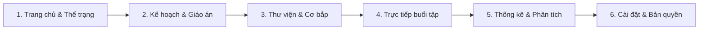

# 📋 KỊCH BẢN CHI TIẾT DEMO ỨNG DỤNG VIETFIT (OPENGYM)

> **Tên ứng dụng:** VietFit (openGym)  
> **Chủ đề:** Ứng dụng theo dõi tập luyện thể hình & thể chất cá nhân (Self-hosted & Privacy-first Workout Tracker)  
> **Công nghệ:** React 19, Vite, Zustand, Node.js API, WebAuthn Passkeys, PWA & Capacitor.

---

## 🛠️ PHẦN 0: CHUẨN BỊ TRƯỚC KHI DEMO

1. **Khởi động ứng dụng:**
   * Backend API: `http://localhost:3000` (đã chạy ngầm)
   * Frontend: `http://localhost:5173` (đã chạy ngầm)
2. **Thiết lập giao diện điện thoại trên máy tính:**
   * Mở trình duyệt Chrome/Edge truy cập: **`http://localhost:5173`**
   * Nhấn phím **`F12`** để mở bảng DevTools.
   * Nhấn tổ hợp phím **`Ctrl + Shift + M`** (hoặc click icon điện thoại ở góc trên bảng DevTools) để chuyển sang giao diện mobile.
   * Chọn thiết bị giả lập: **iPhone 14 Pro** hoặc **Samsung Galaxy S20** (tỷ lệ hiển thị 100%).
3. **Cài đặt ngôn ngữ:** Đảm bảo hệ thống đang ở giao diện **Tiếng Việt** (Vào *Cài đặt (Settings)* ➡️ *Language* ➡️ *Tiếng Việt*).

---

## 🎭 KỊCH BẢN THAO TÁC & THUYẾT TRÌNH CHI TIẾT

---

### BƯỚC 1: TRANG CHỦ & CHECK-IN CÂN NẶNG (HOME)

* **Mục tiêu:** Giới thiệu tổng quan tiến độ tuần và tính năng ghi nhận thể trạng trước buổi tập.
* **Thao tác trên màn hình:**
  1. Click vào tab **Trang chủ** (góc dưới bên trái).
  2. Chỉ vào thanh lịch trên cùng: Thấy các ngày trong tuần (T2 - CN), ngày hiện tại được khoanh màu xanh.
  3. Lướt qua phần **Thử thách trong tháng (Monthly Challenges)**.
  4. Nhấp vào thẻ **Cân nặng / Quick check-in** ➡️ Kéo thanh trượt điều chỉnh cân nặng (ví dụ: 68.5 kg) ➡️ Bấm **Lưu & Bắt đầu** (hoặc Lưu).
* **Lời thoại thuyết minh mẫu:**
  > *"Kính thưa thầy cô/các bạn, đây là giao diện Trang chủ của VietFit được thiết kế chuẩn Mobile-first. Ngay trên cùng, người dùng có cái nhìn trực quan về tuần tập luyện của mình với các ngày đã hoàn thành hoặc ngày nghỉ. Ứng dụng thúc đẩy người tập thông qua các thử thách tháng tự động. Đặc biệt, trước mỗi buổi tập, hệ thống có tính năng Quick check-in để người dùng ghi nhanh cân nặng, từ đó vẽ biểu đồ biến thiên thể trạng chính xác theo thời gian."*

---

### BƯỚC 2: QUẢN LÝ KẾ HOẠCH & GIÁO ÁN TẬP (PLAN)

* **Mục tiêu:** Thể hiện khả năng lập kế hoạch khoa học, linh hoạt và công cụ tăng tiến mức tạ thông minh.
* **Thao tác trên màn hình:**
  1. Bấm vào tab **Kế hoạch** ở thanh menu dưới.
  2. Trình diễn **Bản đồ cơ bắp mini (Mini Body Map):** Chỉ vào từng ngày tập (ví dụ: Thứ Hai - Ngực & Tay sau) ➡️ Các nhóm cơ tương ứng phát sáng trực quan.
  3. Trình diễn **Giáo án mẫu:** Nhấn vào xem các lịch mẫu có sẵn: *Push/Pull/Legs (PPL), Upper/Lower, Full Body, 5×5*.
  4. Bấm vào nút **Chỉnh sửa (Routine Edit)** của một buổi tập:
     * **Kéo thả:** Thử đổi thứ tự 2 bài tập.
     * **Quy tắc tăng tạ (Progression Engine):** Bấm vào 1 bài tập ➡️ Cho thấy các chế độ tăng tạ: *Linear Progression* (tăng đều), *Double Progression* (tăng rep trước khi tăng kg).
     * **Superset:** Cho thấy tính năng ghép 2 bài tập lại để tập nối tiếp.
* **Lời thoại thuyết minh mẫu:**
  > *"Điểm đặc biệt ở phần Kế hoạch là mỗi buổi tập đều tích hợp bản đồ cơ học giải phẫu thu nhỏ, giúp người tập biết ngay hôm nay sẽ tác động vào những nhóm cơ nào trước khi mở ra. Người dùng có thể chọn các giáo án thể hình chuẩn quốc tế hoặc tự thiết kế lịch riêng. Hệ thống tích hợp một 'Progression Engine' tự động tính toán mức tạ cần nâng ở buổi tiếp theo dựa trên hiệu suất tập của buổi trước."*

---

### BƯỚC 3: THƯ VIỆN BÀI TẬP & BẢN ĐỒ GIẢI PHẪU (LIBRARY)

* **Mục tiêu:** Thể hiện kho dữ liệu đồ sộ hơn 5.600 bài tập và khả năng tương tác giải phẫu học.
* **Thao tác trên màn hình:**
  1. Bấm vào tab **Bài tập** ở góc dưới bên phải.
  2. Chuyển sang chế độ **Theo nhóm cơ (By Muscle)**:
     * Trên hình nhân cơ thể 3D/2D, chạm thử vào **Cơ ngực (Chest)** hoặc **Cơ vai (Shoulders)**.
     * Hệ thống tự động lọc ra các bài tập chuyên biệt cho vùng cơ đó.
  3. Tìm kiếm bài tập: Nhập vào thanh tìm kiếm từ khóa: `Bench Press` hoặc `Squat`.
  4. Bấm vào 1 bài tập để mở xem chi tiết:
     * Trình chiếu **ảnh động/video kỹ thuật chuyển động**.
     * Giới thiệu danh sách cơ chính (Primary), cơ phụ (Secondary).
  5. Giới thiệu bộ lọc theo **Hồ sơ thiết bị (Equipment Profile)**: Lọc bài tập theo *Phòng Gym đầy đủ* hoặc *Tập tại nhà chỉ có tạ đơn*.
* **Lời thoại thuyết minh mẫu:**
  > *"VietFit sở hữu cơ sở dữ liệu hơn 5.600 bài tập chuẩn hóa. Thay vì tìm kiếm bằng chữ đơn thuần, người dùng có thể tương tác trực tiếp lên bản đồ cơ thể: đau hoặc muốn phát triển cơ nào chỉ cần chạm vào cơ đó. Mỗi bài tập đều đi kèm hình ảnh mô phỏng chuyển động chuẩn xác, phân tích các nhóm cơ tham gia và hỗ trợ lọc theo dụng cụ người dùng thực tế đang có."*

---

### BƯỚC 4: THEO DÕI BUỔI TẬP THỜI GIAN THỰC (LIVE WORKOUT - ĐIỂM NHẤN CHÍNH)

* **Mục tiêu:** Trình diễn trải nghiệm thực tế khi người dùng đang nâng tạ trong phòng gym.
* **Thao tác trên màn hình:**
  1. Nhấn nút tròn màu xanh **Bắt đầu (Start)** ở chính giữa thanh menu dưới.
  2. **Dữ liệu mốc tự điền:** Chỉ ra rằng mức tạ và số reps của lần tập trước đã được điền sẵn mờ mờ làm mốc gợi ý.
  3. **Ghi nhận hiệp tập:**
     * Nhập mức tạ: `60 kg`, số lần: `10 reps`.
     * Nhấn dấu tick hoàn thành hiệp 1.
  4. **Đồng hồ nghỉ (Rest Timer):** Đồng hồ đếm ngược tự động bật lên (ví dụ: 90 giây) kèm âm thanh khi hết giờ.
  5. **Tính toán bánh tạ (Plate Calculator):**
     * Nhấn vào biểu tượng bánh tạ cạnh mức cân 60kg.
     * Màn hình mở ra hình ảnh trực quan: Mỗi bên đòn barbell 20kg cần lắp một bánh 20kg.
  6. **Thay thế bài tập (Swap Exercise):**
     * Giả lập tình huống: Máy tập ngực đang có người khác sử dụng.
     * Bấm vào menu 3 chấm bài tập ➡️ Chọn **Đổi bài tập (Swap)** ➡️ Chọn bài thay thế tương đương cùng nhóm cơ với 1 chạm.
  7. **Hoàn thành buổi tập:** Bấm **Hoàn thành (Finish Workout)** ➡️ Hệ thống tổng kết tổng khối lượng (Volume) và thông báo Kỷ lục mới (PR).
* **Lời thoại thuyết minh mẫu:**
  > *"Đây là màn hình cốt lõi nhất khi người dùng bước vào buổi tập thực tế. Ứng dụng tự động ghi nhớ mức tạ lần trước để người tập không cần nhớ bằng sổ sách. Khi hoàn thành hiệp, đồng hồ nghỉ thông minh tự kích hoạt. Nếu không biết phải lắp tạ thế nào, tính năng Plate Math sẽ tính chính xác cần lắp mấy bánh tạ mỗi bên đòn. Đặc biệt, nếu máy tập trong phòng gym bị kẹt người, chỉ cần 1 chạm là đổi ngay sang bài thay thế tương đương mà không làm gián đoạn buổi tập."*

---

### BƯỚC 5: PHÂN TÍCH TIẾN ĐỘ & HỒI PHỤC (STATS)

* **Mục tiêu:** Trình diễn năng lực phân tích dữ liệu thể thao chuyên sâu.
* **Thao tác trên màn hình:**
  1. Bấm vào tab **Tiến độ** ở thanh menu dưới.
  2. **Bản đồ hồi phục cơ bắp (Muscle Recovery):** Xem vùng cơ nào màu xanh (đã phục hồi), vùng nào màu vàng/cam (đang mỏi sau buổi tập vừa xong).
  3. **Biểu đồ sức mạnh 1RM (Estimated 1RM):** Xem đường cong tăng tiến sức mạnh tối đa qua các bài tập chính.
  4. **Biểu đồ nhiệt hoạt động (Activity Heatmap):** Bảng màu 365 ngày thể hiện tính chăm chỉ và kỷ luật của người tập.
  5. **Biểu đồ cân nặng mục tiêu:** So sánh cân nặng thực tế với đường mục tiêu (Target line).
* **Lời thoại thuyết minh mẫu:**
  > *"Sau khi tập xong, dữ liệu được chuyển hóa thành các báo cáo trực quan. Thuật toán phân tích mệt mỏi sẽ tính toán dựa trên khối lượng tập để cho người dùng biết nhóm cơ nào cần nghỉ ngơi và nhóm cơ nào đã sẵn sàng cho buổi tập kế tiếp. Biểu đồ 1RM và biểu đồ nhiệt 365 ngày giúp người tập theo dõi sát sao sự tiến bộ của bản thân."*

---

### BƯỚC 6: CÀI ĐẶT, BẢO MẬT & ĐA NỀN TẢNG (SETTINGS)

* **Mục tiêu:** Khẳng định tính bảo mật, tôn trọng quyền riêng tư và công nghệ tự lưu trữ (Self-hosting).
* **Thao tác trên màn hình:**
  1. Bấm vào tab **Cài đặt** (biểu tượng bánh răng).
  2. Trình diễn chuyển đổi **Ngôn ngữ (Tiếng Việt / English)**.
  3. Trình diễn đổi giao diện **Sáng / Tối (Dark / Light mode)**.
  4. Chỉ vào tính năng **Sao lưu & Phục hồi dữ liệu (Export JSON backup)**.
  5. Giới thiệu khả năng đồng bộ với đồng hồ thông minh (Apple Watch, Wear OS, Garmin, Amazfit).
* **Lời thoại thuyết minh mẫu:**
  > *"Cuối cùng là phần Cài đặt. Khác với các ứng dụng thương mại đòi hỏi đăng ký tài khoản đám mây và trả phí định kỳ, VietFit là một hệ thống tự lưu trữ (Self-hosted). Toàn bộ dữ liệu nằm trên thiết bị hoặc máy chủ riêng của người dùng, đăng nhập bảo mật bằng Passkeys vân tay/Windows Hello, hoạt động hoàn hảo ngay cả khi không có kết nối Internet và hỗ trợ kết nối hệ sinh thái đồng hồ thông minh."*

---

## ❓ BỘ CÂU HỎI THƯỜNG GẶP (Q&A) KHI BẢO VỆ ĐỀ TÀI

| Câu hỏi | Câu trả lời trọng tâm |
| :--- | :--- |
| **1. Ứng dụng này giải quyết vấn đề gì khác biệt so với các app gym trên thị trường?** | Đa số app hiện nay thu phí định kỳ, lưu dữ liệu người dùng trên máy chủ bên thứ ba và có quảng cáo/theo dõi. VietFit là mã nguồn mở, người dùng tự làm chủ dữ liệu (Self-hosted), bảo mật tuyệt đối, hoạt động offline và tích hợp bản đồ cơ học giải phẫu sâu. |
| **2. Tại sao lại dùng Zustand thay vì Redux?** | Zustand nhẹ hơn rất nhiều, không có boilerplate code rườm rà, tích hợp mượt mà với React 19 và hỗ trợ đồng bộ trực tiếp ra LocalStorage / IndexedDB rất nhanh, phù hợp cho ứng dụng PWA chạy trên điện thoại. |
| **3. Cơ chế đăng nhập Passkeys (WebAuthn) hoạt động ra sao?** | Ứng dụng không lưu mật khẩu dạng chuỗi text trên server. Khi đăng ký, thiết bị tạo ra một cặp khóa công khai (Public Key) và khóa riêng tư (Private Key). Private Key lưu an toàn trong chip bảo mật phần cứng của máy tính/điện thoại, đăng nhập bằng sinh trắc học (vân tay/khuôn mặt). |
| **4. Khi mất mạng (Offline), dữ liệu được xử lý thế nào?** | Frontend lưu toàn bộ trạng thái vào LocalStorage và bộ nhớ máy. Mọi buổi tập đều được ghi nhận bình thường offline. Khi phát hiện có kết nối mạng trở lại, tiến trình nền tự động đồng bộ (sync merge) về server mà không làm gián đoạn người dùng. |
| **5. Công thức tính 1RM (One Rep Max) trong ứng dụng là gì?** | Hệ thống sử dụng các công thức kinh điển trong khoa học thể thao (như Brzycki, Epley, Wathan) dựa trên mức tạ và số lần lặp thực tế để suy ra mức tạ tối đa có thể nâng 1 lần duy nhất với độ chính xác cao. |

